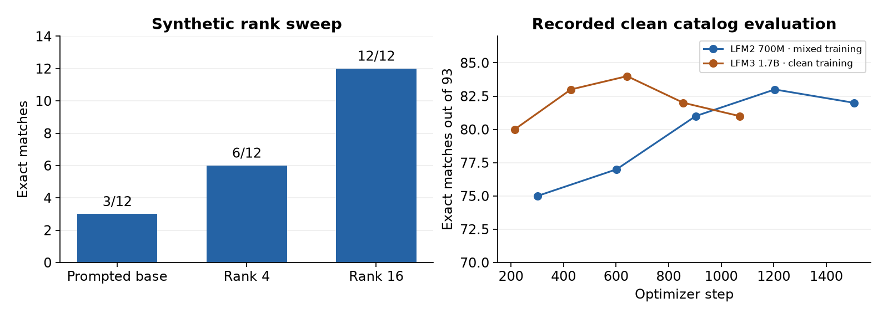

# LoRA on LFM2

How much does adapter rank affect LFM2 catalog segmentation under a fixed training budget?

`python -m adaptation.lfm_lora.lfm_lora --steps 2 --out runs/lfm-smoke`

The smoke run trains, saves, reloads, and scores an adapter. The default training budget is 60 steps with batch size one. For ablations, keep step counts equal and use separate output paths while varying only rank or target modules.

## Results at a glance



## Synthetic catalog rank sweep

LFM2‑700M on RTX 3060 Ti, BF16, 30 optimizer steps, seed 7, attention projections only. Both adapters used batch size one, the same split and generation budget, and a constant alpha-to-rank ratio of two.

| Model | Exact match | Mean span F1 |
| --- | ---: | ---: |
| Prompted base | 3/12 | 0.329 |
| Rank 4 | 6/12 | 0.761 |
| Rank 16 | 12/12 | 1.000 |
| Learned boundary tagger | 12/12 | 1.000 |
| Boundary rules | 12/12 | 1.000 |

```sh
python -m adaptation.lfm_lora.lfm_lora --steps 30 --rank 4 --out runs/lfm-r4
python -m adaptation.lfm_lora.lfm_lora --steps 30 --rank 16 --out runs/lfm-r16
python -m structured_outputs.catalog_segmentation.sequence_tagger
```

The rank sweep uses one seed and 12 held-out synthetic examples. The exact punctuation cue also lets a linear tagger solve the task. Use noisier held-out formats and repeat across seeds before drawing conclusions about which rank generalizes.

## Recorded catalog runs

On the same 93-row clean evaluation set, the prompted LFM2-700M baseline scored 0 exact matches. The first adapter scored 47, extending training context to 1,536 scored 50, and raising rank to 16 scored 55. The hard-case oversampling and epoch change scored 53. A subsequent run targeting extra MLP projections scored 56. The same recipe trained on clean data scored 71.

A later 700M run on an RTX 3060 Ti mixed clean and reconstructed pages and scored 82/93 in one clean evaluation dump. A separate dump scored 71/93 on the clean slice and 0/8 on the reconstructed slice it covered. The reconstructed slice covered only 8 of 23 prepared evaluation rows. A separate LFM3-1.7B run reached 81/93, while its longer-context variant reached 75/93. These are local task results with several co-varying settings, so use a fixed split and equal budgets to attribute changes in a new run.

Use the learned tagger and punctuation rules as controls. The synthetic corpus has a consistent boundary cue, so perfect scores there show the mechanics of the evaluation. Real OCR can merge punctuation with tokens, drop separators, and introduce unseen formats.

The [tagger and boundary-rule controls](../../structured_outputs/catalog_segmentation/) share the seeded synthetic evaluation data and span F1 definition. Exact match also checks span order. Record both metrics, model ID, seed, and training budget for future runs.

## Checkpoint evaluation data

The [checkpoint score CSV](clean_checkpoint_scores.csv) contains 41 recorded evaluations on the same 93-row clean catalog split, run on an RTX 3060 Ti (8 GB). Exact match requires the entire ordered list to match. Mean span F1 averages bag-of-exact-span F1 over rows. The four bucket columns give exact matches over rows grouped by the gold span count. Evaluation time is in seconds for all 93 rows.

In the mixed clean and reconstructed LFM2-700M run, checkpoint 1204 scored 83/93 exact and 0.9574 mean span F1. The final checkpoint 1505 scored 82/93 and 0.9553. Only three of six rows with eight or more gold spans matched exactly at checkpoint 1204. This checkpoint sweep used the clean split for comparison and the published commands reproduce the independent synthetic experiment above.
