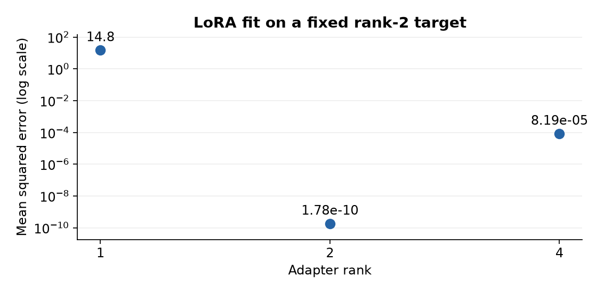

# LoRA from scratch

How does adapter rank affect the fit to a fixed rank-2 residual?

## Worked example

Suppose a frozen layer maps eight input features to four outputs and the new task requires two independent corrections. The experiment constructs exactly that target. A rank-1 adapter has only one correction direction and finishes at 14.85 MSE. Rank 2 can fit both directions and brings the error close to zero. This shows why adapter rank can matter before spending GPU time tuning a language model.

`python -m adaptation.low_rank.low_rank`

## Results

With 128 synthetic samples, the same frozen linear map, seed, and 300 Adam steps, CPU MSE was 14.8470 at rank 1, below 0.000001 at rank 2, and 0.000082 at rank 4. Rank 2 had enough capacity for this target. The rank-4 result can vary with initialization and training budget.

This experiment isolates the adapter on one linear map and one seed. It measures training fit on the constructed target.

Inspect which weights get gradients and how the zero-initialized output projection affects the first step.
