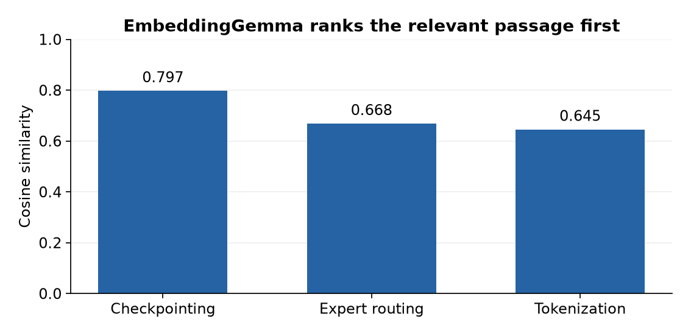

# EmbeddingGemma retrieval

Does cosine similarity rank the document about activation checkpointing first for a query about backward-pass memory?

`python -m embeddings.embedding_gemma.embeddings`

The corpus contains three technical passages and the run uses separate document and query prompts. Add a lexical distractor and predict the ranking before rerunning.

## Recorded run

For “What saves memory during backpropagation?”, the pinned text-only EmbeddingGemma model returned these cosine scores on the three built-in documents.

| Document topic | Cosine similarity |
| --- | ---: |
| Activation checkpointing | 0.797 |
| Gated routing | 0.668 |
| Tokenization | 0.645 |

Checkpointing ranked first for this query. A single query and three documents give a retrieval smoke check with no coverage of chunking tradeoffs or ranking quality on larger corpora.
