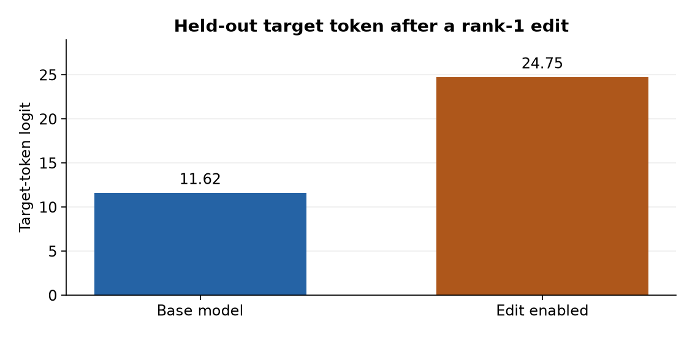

# Fact injection with EncodeMemory

Can a rank-1 edit add an association to Qwen2.5-1.5B that transfers to a new phrasing and preserves the unrelated control's top token?

```sh
python -m model_editing.fact_injection.wrap_noop
python -m model_editing.fact_injection.inject_fact
```

## Setup

Treat layer 14’s Qwen MLP down-projection as a map from an activation key to a residual-stream value. A rank‑1 term adds a learned value weighted by its overlap with the current activation. In the original run, capturing the final prompt token picked up shared wording about a city and made an unrelated subject respond to the edit. Capturing the last subject token preserved the unrelated control’s top token. Fitting across several sentence frames helped the edit transfer to a held-out phrasing.

## Results



The course rerun moved the held-out target token from a logit of 11.62 to 24.75 and made it top‑1. The control's top token stayed the same, although its maximum logit delta was 9.260. Disabling the edit restored the original logits exactly. The held-out continuation questioned the injected association after emitting the target token, so top‑1 readback is a limited success criterion.
