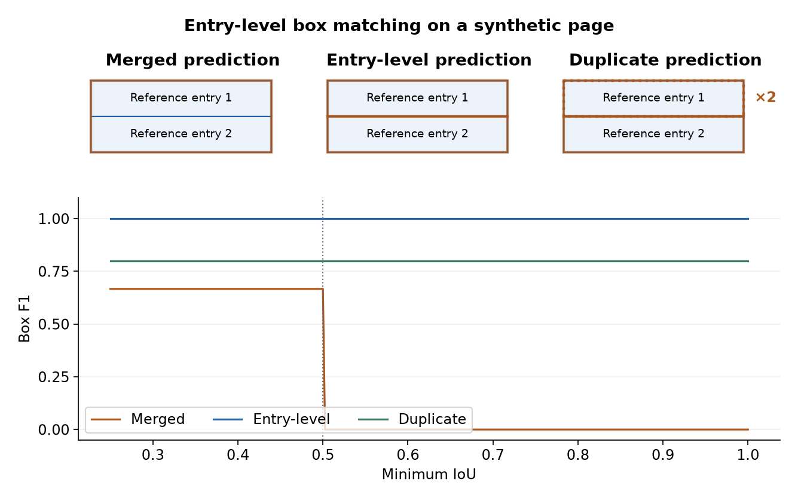

# Layout box evaluation

A catalog detector can cover the right part of a page while merging two entries into one box. This experiment measures how that error, and a duplicate prediction, affect an entry-level layout score.

## Setup

The [synthetic page fixture](synthetic_boxes.json) contains two adjacent 100 × 20 reference boxes. Compare three predictions for the same page.

- **Merged** predicts one box covering both entries. Its IoU with either reference is 0.50.
- **Entry-level** predicts both reference boxes exactly.
- **Duplicate** predicts both reference boxes and repeats the first one.

A prediction can match a reference when their intersection over union meets the threshold. Maximum one-to-one matching gives each reference and prediction at most one match. Precision is matches divided by predictions, and recall is matches divided by references.

## Results



| Prediction | Matches at IoU ≥ 0.50 | Precision | Recall | F1 at 0.50 | F1 at 0.75 |
| --- | ---: | ---: | ---: | ---: | ---: |
| Merged | 1 | 1.000 | 0.500 | 0.667 | 0.000 |
| Entry-level | 2 | 1.000 | 1.000 | 1.000 | 1.000 |
| Duplicate | 2 | 0.667 | 1.000 | 0.800 | 0.800 |

Above 0.50, the merged prediction has no eligible reference. The duplicate adds a false positive at every threshold in the [IoU sweep](iou_sweep.csv). The plot uses synthetic geometry. Performance on scanned pages would require a labeled page set and predictions from a detector.

## Reproduce

Run `python -m structured_outputs.box_evaluation.box_evaluation` from the repository root for the merged and entry-level comparison. To repeat the fixture sweep, including the duplicate case, run:

```sh
python - <<'PY'
import json
from pathlib import Path

from structured_outputs.box_evaluation.box_evaluation import box_f1

fixture = json.loads(Path("structured_outputs/box_evaluation/synthetic_boxes.json").read_text())
for name, boxes in fixture["predictions"].items():
    for threshold in fixture["thresholds"]:
        print(f"{name:12s} IoU >= {threshold:.2f}  F1 = {box_f1(boxes, fixture['gold'], threshold):.3f}")
PY
```
