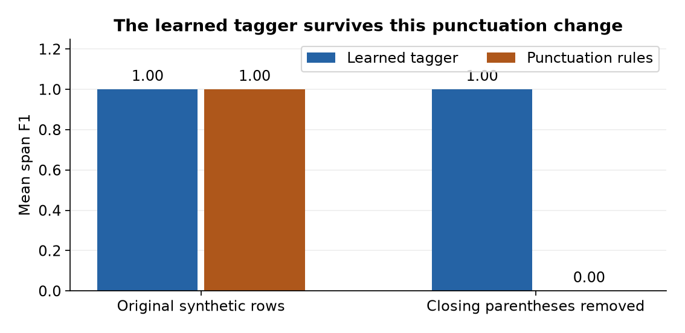

# Catalog segmentation

Can a learned boundary tagger and a punctuation rule agree on where entries start, and how do they behave when punctuation changes?

## Worked example

Consider the first two spans from a synthetic held-out row: `Elm. Music; vol. 8 (1930)` and `Elm. Letters; vol. 3 (1931)`. When OCR joins them, the punctuation rule looks for `) ` before the start of the next entry. Drop the closing parenthesis and that cue disappears. The ablation tests whether the learned tagger can still find the boundary while preserving the remaining source text.

## Setup

A linear model tags entry starts using character context and capitalization. It trains for 100 optimizer steps on 96 synthetic rows from seed 7. The rule splits after a closing parenthesis followed by a space. Both scored the same 12 held-out rows from seed 11. For the punctuation ablation, I removed all closing parentheses from each input and reference span, then ran both segmenters again without retraining.

Run the original comparison with `python -m structured_outputs.catalog_segmentation.sequence_tagger`.

## Results

| Input | Learned exact match | Learned span F1 | Rule exact match | Rule span F1 |
| --- | ---: | ---: | ---: | ---: |
| Original synthetic rows | 12/12 | 1.000 | 12/12 | 1.000 |
| Closing parentheses removed | 12/12 | 1.000 | 0/12 | 0.000 |

Exact match checks the full ordered list. Mean span F1 gives partial credit for exact spans across rows. The learned model still found the boundaries under this one perturbation. The rule lost its only delimiter. Both conditions retain the synthetic templates and capitalization, so this result covers one punctuation change on one split. See the [LFM2 report](../../adaptation/lfm_lora/) for separate catalog runs.
