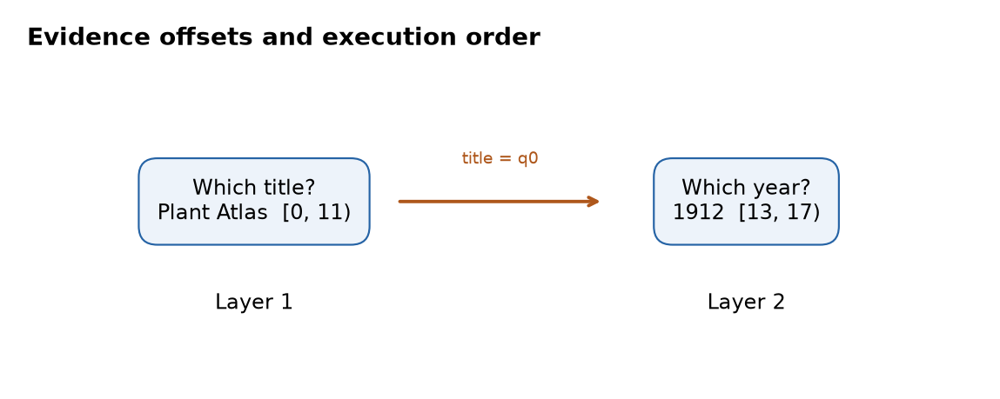

# Extraction with evidence

How does the evidence compiler handle changed quotes, ambiguous matches, or cycles?

## Worked example

From `Plant Atlas, 1912`, an extractor proposes `year = 1912`. The compiler ties the proposal to characters `[13, 17)` and schedules it after the title choice. If the source also says `revised 1912`, the same quote can point to either occurrence and the compiler rejects it. This matters when a reviewer needs to trace a field back to a specific passage.

`python -m structured_outputs.extraction.extraction`

## Setup

Compile a tiny proposal with two decisions against a single source string. The compiler resolves each quote to a unique half-open character span and topologically orders the decision graph.

## Synthetic run

For `Plant Atlas, 1912`, the compiler locates the title at character offsets `[0, 11)` and the year at `[13, 17)`. It schedules the title decision first and makes the year decision conditional on the title choice. The [compiled example](compiled_example.json) records the offsets and execution order.

| Perturbation | Observed response |
| --- | --- |
| Replace the year evidence with `1902` | Rejected because the quote occurs zero times |
| Repeat `1912` in the source | Rejected because its offset is ambiguous |
| Make the year decision depend on itself | Rejected because the graph contains a cycle |

These cases evaluate deterministic validation on synthetic text. Extraction accuracy on manuscript OCR also depends on the model proposing the right quotes and fields.

## Archive use case

The published archive example for shelfmark `M. eh. q. 2` describes 389 paper leaves, dimensions of 214 × 116 mm, and Erfurt as the place of production. The intended mapping gives each value its own field and places watermarks and chapters in child records. That is the downstream reason to keep evidence tied to individual fields. This archive example illustrates the target schema. The measured compiler behavior above comes from the synthetic fixture. [Manuscript extraction write-up](https://0chonko.github.io/blog/from-manuscript-transcriptions-to-json-a-configurable-extraction-pipeline/)
