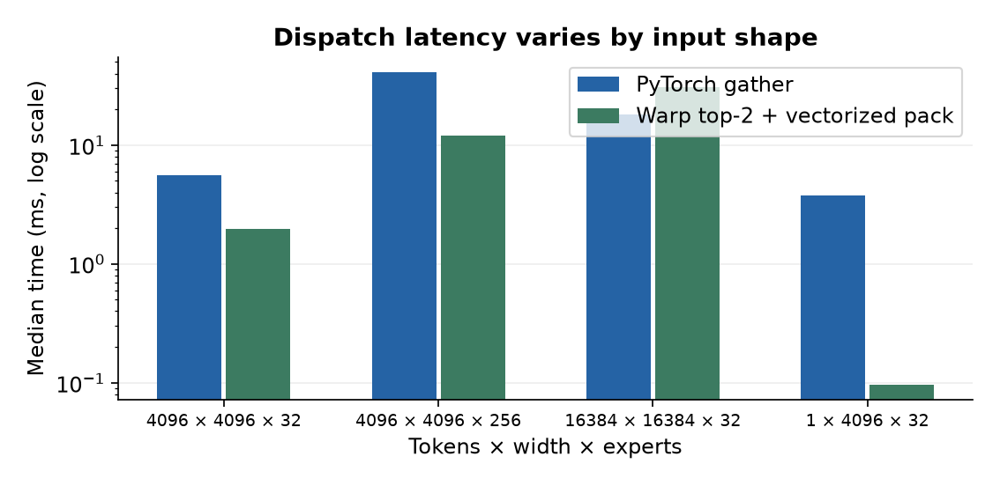

# Fused dispatch timing

How did histogram, scan, and expert-major packing compare with expert-by-expert gather?

## Worked example

For a single-token routing and packing input with width 4,096 and 32 experts, the PyTorch gather path took 3.758 ms and the fused variant took 0.097 ms. At 16,384 tokens and width 16,384, the same fused variant lost to PyTorch. The two shapes show why deployment measurements should include both decoding and large batches before choosing a dispatch implementation.

The RTX 3060 Ti runs used top-2 routing. Times are milliseconds.

## Results

| Tokens × width × experts | PyTorch gather | Global histogram + scalar pack | Privatized histogram | Vectorized pack | Warp top-2 + vectorized pack |
| --- | ---: | ---: | ---: | ---: | ---: |
| 4,096 × 4,096 × 32 | 5.595 | 3.043 | 3.038 | 1.984 | 1.979 |
| 4,096 × 4,096 × 256 | 40.798 | 13.026 | 13.031 | 12.000 | 11.941 |
| 16,384 × 16,384 × 32 | 18.080 | 47.307 | 47.406 | 30.932 | 30.903 |
| 1 × 4,096 × 32 | 3.758 | 0.205 | 0.205 | 0.098 | 0.097 |

Vectorizing the pack step improved the fused path at these shapes. Privatizing the histogram and then changing top‑2 had little effect in the recorded comparisons. The largest shape still favored the PyTorch reference. These are single-device results from the original CUDA benchmark.

## Nsight Systems capture

For the 4,096-token, width-4,096, 32-expert shape, the PyTorch baseline issued 19,650 kernel launches and 3,300 stream synchronizations over 50 timed iterations. The v6 vectorized path used five launches per iteration and had no stream synchronization in the timed loop. Its gate GEMM accounted for 75.8% of GPU kernel time and packing accounted for 23.2%.

## Run data

The [timing CSV](timings.csv) includes the full comparison matrix. `T`, `H`, `E`, and `k` are token count, model width, expert count, and routing fan-out. Each reported time is the median of three trial means, with 50 CUDA-event measurements per trial. In CSV order, `baseline` is PyTorch gather, `v4` is global histogram with scalar packing, `v5` privatizes the histogram, `v6` vectorizes packing, and `v7` adds warp top-2. The Triton runs failed because the local CUDA driver build lacked `Python.h`. Those timing cells are empty.
