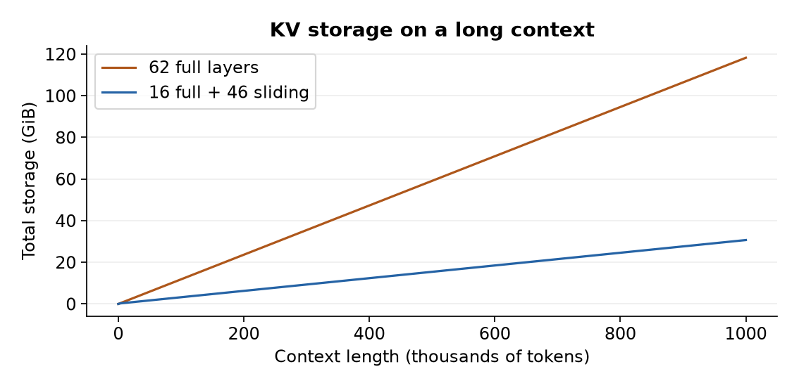

# KV-cache memory

How do KV head count, element size, and the attention window affect the KV-cache memory slope?

`python -m systems.kv_cache.kv_cache`

The example counts keys and values across 16 full and 46 sliding-window layers. At one million tokens, each new token adds 32 KiB across the full layers, or 4 KiB per device under ideal eight-way head sharding. Sliding layers contribute a bounded allocation. The formula excludes padding and allocator overhead.

## Example calculation

With 16 KV heads of width 64, one byte per element, a 2,048-token sliding window, and eight-way head sharding, the calculator reports the following storage estimates.

| Context tokens | Total GiB | GiB per device |
| ---: | ---: | ---: |
| 1,024 | 0.121 | 0.015 |
| 32,768 | 1.180 | 0.147 |
| 1,000,000 | 30.697 | 3.837 |
