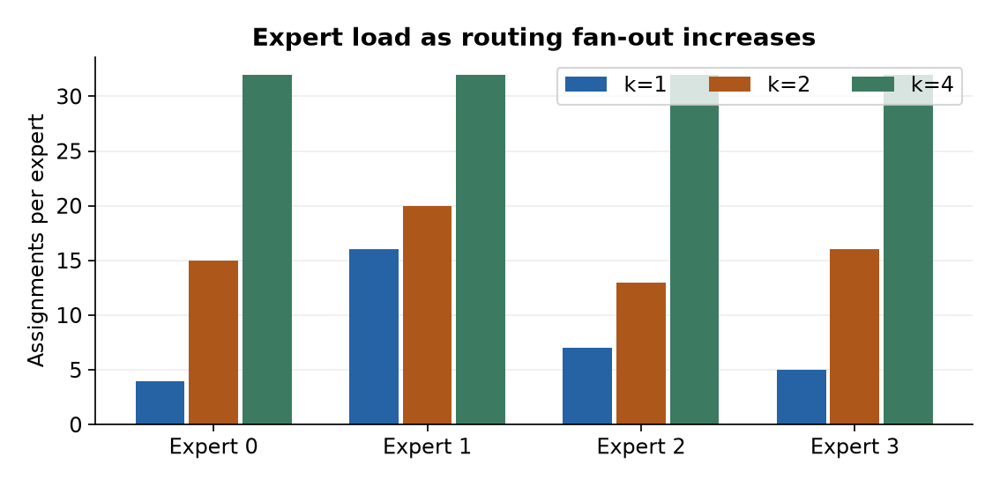

# Mixture-of-experts routing

How does top-k affect total expert assignments and the load on the busiest expert?

## Worked example

With 32 tokens and four experts, top-1 sends 16 tokens to the busiest expert. Top-2 doubles total assignments from 32 to 64 and sends 20 to that expert. The comparison shows why routing fan-out affects both the total work and the largest workload any one expert has to handle.

`python -m systems.moe_routing.routing`

Sweep top-k on identical logits. The [dual-input ablation model](dual_input_moe.py) routes from embeddings and sends contextual states to experts. Its expert forward pass uses dense sequence attention, so assignment sparsity alone cannot establish a speedup. To compare learned top-k with label-forced routing, track task quality, load by expert, and total assignments.

## Synthetic run

The routing demo reuses the same 32 tokens and four experts for each fan-out, with seed 7. This workload counts assignments on a synthetic batch. Runtime and task quality require separate measurements.

| Top-k | Assignments | Expert counts |
| ---: | ---: | --- |
| 1 | 32 | 4, 16, 7, 5 |
| 2 | 64 | 15, 20, 13, 16 |
| 4 | 128 | 32, 32, 32, 32 |
