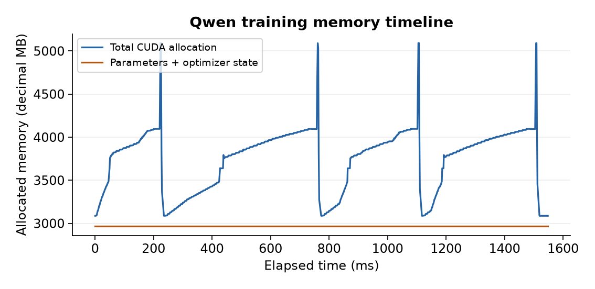

# Training-step profiling

How do time and memory break down across the forward, backward, and Adam optimizer phases?

## Worked example

If a training step runs out of memory, the phase matters. In the recorded Qwen timeline, parameters and optimizer state together occupy 2,964.2 MB, while the sampled peak reaches 5,092.6 MB during an optimizer phase. Looking at the timeline helps distinguish memory held throughout the step from short-lived peaks before deciding what to change.

`python -m systems.step_profile.step_profile`

Compare parameter, gradient, and Adam state bytes. Add `--device cuda` to report peak CUDA allocation. Treat single-run times as illustrative.

## Synthetic run

On an RTX 3060 Ti with PyTorch 2.13.0+cu130, the seed-7 synthetic step allocated 17,302,528 bytes at peak. Parameters and gradients each occupied 34,176 bytes, and AdamW state occupied 68,400 bytes. This is one profiled step on a batch of two sequences of 24 tokens through a single width-32 encoder layer.

## Recorded Qwen profiles

These exports are from the original CUDA training profiler for Qwen2.5-0.5B-Instruct. The source configuration uses one 256-token chunk per step and AdamW. The CSVs describe two profiler runs. In the timeline, observed allocation peaked at 5,092.6 MB during an optimizer phase, while parameter and optimizer state occupied 2,964.2 MB together. The peak is the largest recorded sample.

- [Operator profile](qwen_operator_profile.csv) reports total and self CPU and CUDA times in microseconds, along with call counts and profiler memory deltas in bytes. Total times can include nested operations.
- [Memory timeline](qwen_memory_timeline.csv) reports elapsed milliseconds and memory in decimal MB. Rows identify forward (`fwd`), backward (`bwd`), and optimizer (`opt`) phases. `activ_mb` is the allocation remaining after subtracting parameters, gradients, and optimizer state. `autograd_mb` counts tensors saved for backward. These columns describe overlapping accounting views.
