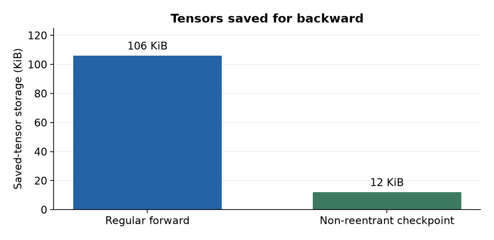

# Activation checkpointing

How much saved-tensor memory does non-reentrant activation checkpointing save for the same transformer block, inputs, and loss?

## Worked example

A training step needs intermediate values again during backpropagation. For example, this encoder block can keep its forward intermediates or recompute them in backward. In the measured step, checkpointing reduced saved-tensor storage from 106 KiB to 12 KiB and preserved the gradients. That is the tradeoff to check when activations limit batch size.

`python -m systems.training_memory.training_memory`

## Results

Saved-tensor bytes dropped from 108,544 to 12,288 while loss and parameter gradients matched. The run used a seed-7 batch of two sequences of 24 tokens and one width-32 Transformer encoder layer. The 88.7% reduction is specific to saved tensors in this workload. The autograd save hook measures tensors submitted for saving. Views, repeated saves, and allocator behavior affect how that count relates to peak allocation. Try increasing sequence length while holding model width fixed.
